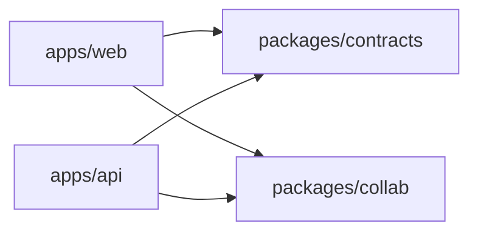

# Architecture

A React single-page app and a Fastify API in one npm-workspaces repo, sharing one contract package; PostgreSQL is the only store of record. The design idea everything follows: **the server decides what is committed and who wrote it** — clients render optimistically, but authorship and "saved" come from the server ([ADR-0002](adr/0002-collaboration-and-author-authorization.md), [ADR-0003](adr/0003-postgres-and-durable-commit.md), [ADR-0006](adr/0006-formal-stack.md)).

## Current decisions

What is decided today, by scope. Each line is the current answer; the linked record says why. When a record is superseded, update its line in the same PR (`verify-decision-format` rejects links to superseded or deprecated records here).

| Scope | Current decision | Record |
| --- | --- | --- |
| 领域 | One personal diary per owner/date; one fixed partner per account in the first release, one permanent pair space and separate binding periods; private date selections control live views, stopping freezes a readable version and explicit reopening grants the latest authorized owner/partner version. Unread is judged by character identity; the day list merges both people's diaries by date and counts only text already in a history point; a day with the partner's shared diary opens both diaries stacked and editable. Pages share one top navigation bar (此刻, 日记, 一起, 设置) listing only reachable pages. The home shows paired windows, both local times with their waking overlap, and recent dates with who wrote and where the partner has new content, but never diary text. The two mascots in the windows can be poked and petted: one's own only plays in the browser, the partner's is sent and shown once when they next open the home, kept only as an unseen count; the partner's mascot sleeps by their sleep schedule, never by whether they are online. The diary page keeps a date index beside one main area that switches between continuous reading (all diaries newest first in full, loaded on demand, two-way date jumps, up/down unread jumps, diaries being written collapsed) and one date's two diaries; returning to continuous reading restores its position; every diary opens there, with no single-diary page. Feature pages are laid out by their content. Records of the space features beyond the diary belong to the space, their text only to its author; state changes keep the current state on the record plus an append-only history; writes need an open binding and are read-only after unbinding; they stay out of Google copies; unread is judged per record once seen; a feature may keep private records hidden from the partner until it reveals them (gift surprises). Anniversaries and gift dates follow the partner's local date, except one's own birthday, and fall back to one's own date when the partner's zone is unknown Shared pages are plain-text documents of the pair on the diary commit chain: each person changes only their own characters, either person renames or deletes a page. | [spaces-and-invitations](adr/2026-10-25-spaces-and-invitations.md), [ADR-0001](adr/0001-diary-domain-and-time.md) (remaining authorship/time rules), [unread-and-day-page](adr/2026-10-28-unread-and-day-page.md), [opening-book-home](adr/2026-10-31-opening-book-home.md), [book-frontend-workspace](adr/2026-11-01-book-frontend-workspace.md), [digital-paper-interface](adr/2026-11-03-digital-paper-interface.md), [drop-single-diary-page](adr/2026-11-03-drop-single-diary-page.md), [window-mascots](adr/2026-11-03-window-mascots.md), [space-records](adr/2026-10-29-space-records.md), [partner-local-dates](adr/2026-10-30-partner-local-dates.md), [shared-pages](adr/2026-11-04-shared-pages.md) |
| 协同 | The server enforces character authorship on every edit path; history is read-only with no rollback exception. The adopted baseline uses Yjs `Y.Text`, server update checks and a custom ProseMirror binding | [ADR-0002](adr/0002-collaboration-and-author-authorization.md), [ADR-0006](adr/0006-formal-stack.md), [diary-collaboration-kernel](adr/2026-10-26-diary-collaboration-kernel.md) (supersedes ADR-0006 items 15, 17) |
| 存储 | PostgreSQL is the store of record; "saved" only after commit; backups through a transactional outbox | [ADR-0003](adr/0003-postgres-and-durable-commit.md) |
| 备份 | The server owns recovery: PostgreSQL is archived continuously, encrypted, to Cloudflare R2 (any minute of the last 30 days, a monthly backup kept for good, a weekly automatic restore drill, alerts from an off-server check-in). Each person's own Google Drive holds only a one-way readable Doc per day, laid out like the day page | [server-backup-and-google-docs](adr/2026-10-28-server-backup-and-google-docs.md), [ADR-0004](adr/0004-google-export-and-recovery.md) (one-way copy, Drive authorization apart from login) |
| 技术栈 | Node 26, npm workspaces, TypeScript 6, React + Vite, Fastify, Drizzle, Zod contracts with generated OpenAPI, Vitest + Playwright | [ADR-0006](adr/0006-formal-stack.md) |
| 认证 | Better Auth for Google login and database sessions only; domain `users` separate from the auth tables; no merge by email; no Google tokens kept for login | [authentication-and-sessions](adr/2026-10-24-authentication-and-sessions.md) |

The personal-diary and sharing product rules were confirmed on 2026-10-25, narrowed on 2026-10-26 to a fixed partner after the first binding; the linked implementation ADR is implemented for relationship management and range configuration (storage, API and desktop screens). Its independent delivery is relationship management and private date-range configuration, with no diary content or Yjs. Since kernel phase 4, confirming a range for the open period opens the covered diaries and freezes the ones it no longer covers (kernel D5); ranges confirmed before that were cleared by migration `0004` and must be confirmed again before anything is published. The first release has only the diary owner and their fixed partner as text authors, with no partner selector or content branches per partner. Ending a binding does not release the permanent pairing; only the original pair can restore collaboration. Wrong-account correction and changing partners are deferred in [future features](future-features.md), with no reset flow promised. Shared versions must not expose unauthorized dates or private changes made after sharing stopped. Private date settings and unshared diary existence are not recipient metadata. A personal latest view and a frozen historical view have separate identities. Rebinding alone does not reopen sharing; explicit reopening can expose the latest authorized version, including intervening changes.

The [diary collaboration kernel](adr/2026-10-26-diary-collaboration-kernel.md), adopted on 2026-10-26, records the confirmed product rules and the full technical design. History is read-only with no rollback exception; viewing it preserves the current text, pending edits and undo state. The selected route cleans deleted content in an isolated copy while retaining character IDs, replaces active instances, and re-encodes outbound deltas from accepted clean state. An application-owned IndexedDB journal persists edit order, receipts and recovery drafts with a shared sender lock. Fixed batches are persisted before sending; each new batch commits atomically as one PG version, with no partial success. Recovery drafts support viewing, copying and explicit deletion. Text and transient cursors share a connection but are handled separately; cursor display waits for referenced text when needed. History uses five-minute groups, a final committed version after two minutes without text commits, independent sharing boundaries and long-term retention. Read coverage retains character identity across sharing rounds; backup tasks bind an authorized version. Current text loads before on-demand history. [Design evidence](validation/diary-kernel-design-2026-10-26.md) covers temporary baseline and journal probes, and [batch evidence](validation/diary-kernel-batch-2026-10-26.md) covers fixed-batch fault recovery against real PostgreSQL; production integration and performance targets remain unverified. It also fixes the technical design: the internal version never leaves the server (clients see `(generationId, seq)` and random commit IDs); opening many diaries prebuilds baselines outside locks and switches them in one short transaction; commits lock only the diary row; every partner-facing output goes through one authorized-state reader; the first release runs a single API instance. It partially supersedes ADR-0006 items 15 and 17 (its D12). Phase 1, the pure model in `packages/collab` with the dependency-direction check, and phase 2, the personal-diary server in `apps/api` (tables, commit chain, receipts, sync socket, history), are implemented; phase 3 (editor and journal: the editor binding, the IndexedDB journal, the sender, the sync client, and the diary screen with save status, recovery drafts and own history in `apps/web`) is implemented; phase 4 (sharing) is in progress: saving a range, binding, creating a covered diary and unbinding open and freeze shares on the server (two-phase opening, migration `0004`), and the partner lists, opens, follows and writes shared diaries and reads their history through the authorized-state reader (`reader/`); sign-out closes sockets at once, and each reader's own read coverage is recorded by character identity (`reading/`, `read-tracker`). In `apps/web` the journal switches generations by receipt, the space page opens and stops sharing with a preview, and the partner reads and writes shared diaries with author colors, "只看我的文字", character origins and each other's carets, relayed in memory to whoever reads the same generation (`shared-diaries`, the `diary` screen).

The [unread-and-day-page](adr/2026-10-28-unread-and-day-page.md) design (stage 2 reading) is implemented: `GET /api/days` and `GET /api/days/:date` merge both people's diaries by date in the authorized-state reader and mark list unread by character identity, counting only text a history point already holds; that one list with initial avatars (`avatar`) was the home page's until the opening-book home, and the diary workspace's feed (`day-feed`) took its place; the diary screen offers its unread without scrolling, jumps to it and keeps the reading position across remote commits and filters; and `/days/:date` in `diary` stacks both diaries of a date as two independent sessions. Its manual check with a real IME and the system clipboard is [recorded](validation/unread-and-day-page-manual-2026-10-28.md) separately.

## Modules

| Module | Owns | Does not own |
| --- | --- | --- |
| `packages/contracts` | Request, response and WebSocket message schemas; the route table; error codes with their recovery categories | Behavior, I/O |
| `packages/collab` | The pure collaboration model: `Y.Text('body')` document, edit validation, clean baselines, batch digest, author derivation; sub-modules per [kernel D11](adr/2026-10-26-diary-collaboration-kernel.md) | I/O, sessions, authorization, PG, UI |
| `apps/api` | HTTP surface, validation, serialization, OpenAPI generation, login and sessions (Better Auth), the domain `users` table, personal diaries, spaces, invitations and sharing ranges, the two-clocks settings, the shared rules of space records and wishes and gifts, anniversaries and shared pages on them, the link-preview reader, the commit chain and the collaboration socket in [kernel D11](adr/2026-10-26-diary-collaboration-kernel.md) layers (transport → services → store); later the backup worker entry | UI, editor behavior |
| `apps/web` | Screens, routing, server-state caching, the typed API client; the editor binding (ProseMirror ↔ `Y.Text`, operations with intent), the IndexedDB journal, the sender, the sync client and the diary screen that wires them, the diary page with a date index beside one main area, the feed of all diaries or the day page that stacks two, the own history view, the opening-book home, the relationship screens (home section, `/join`, the space page and the range editor), two clocks (the home time area and `/clocks`), the space features' shared parts (`space-common`) and wishes and gifts (`/wishes`), anniversaries (`/anniversaries`), shared pages (`/shared-pages`), per [kernel D11](adr/2026-10-26-diary-collaboration-kernel.md) | Authorship or commit decisions |
| `ops/backup` | The server backup of the database that holds real diaries: the WAL-G PostgreSQL image and compose overlay, the daily backup, the one restore command, the weekly drill and its checks, the restore runbook ([server-backup-and-google-docs](adr/2026-10-28-server-backup-and-google-docs.md) D2–D4) | Anything the app imports; Google copies |
| `prototypes/` | Frozen behavior baseline and evidence for ADR-0002/0005/0006 | Anything production imports |

Planned, created by the first change that needs it: the worker entry in `apps/api`. `packages/collab` has no app dependencies so it can be extracted later (ADR-0006 §18); the API uses it since kernel phase 2, the web app's editor binding since phase 3.

Each module's contract is in its `README.md`; read it before editing.

## Dependency direction

Arrows mean "may import". Anything not drawn is forbidden.

- `packages/*` never import `apps/*`; `apps/web` and `apps/api` never import each other. A type both need belongs in `packages/contracts`.
- Nothing outside `prototypes/` imports from `prototypes/`.
- Packages import only their listed externals (`contracts`: `zod`; `collab`: `yjs`), plus `vitest` in tests.
- Inside `packages/collab`, sub-modules (`validate`, `baseline`, `digest`, `authorship`) import only the shared `doc` model, never each other ([kernel D11](adr/2026-10-26-diary-collaboration-kernel.md)).
- Inside `apps/web/src`, `editor-binding` and `journal` import no other web sub-module, so the editor knows neither the network nor IndexedDB and the journal neither the editor nor the network; `sender` imports only `journal` and reaches the network through the transport it is given; `sync-client`, `read-tracker` and `shared-diaries` import only `api`; `avatar` imports nothing and the feed in `day-feed` and the day page in `diary` use it; `day-text` imports nothing and `day-feed` builds on it; `two-clocks` imports only `api`; `space-common` imports only `api`, and each space feature (`wishes`, `anniversaries`, `shared-pages`) imports `api` and `space-common`, never another feature, and `shared-pages` also takes its text from `diary` and its left-behind input from `journal`; `diary`, the screen, wires them, puts the date index beside the feed or the day page, and nothing below imports it (kernel D11). The relationship screens import no diary module: `sharing-range` imports nothing, `relationship` owns the relationship queries, and `join` and `space` build on both.
- Inside `apps/api/src`, transport (`routes`, `ws`) imports services (`commit`, `diaries`, `reader`, `history`, `events`, and `bindings`, `sharing` for relationships), services import the `store`, never upwards; transport never imports the `store`, `events` imports no other service, and `clocks` (two-clocks settings) imports only the `store`; `space-records` imports only the `store` and knows no feature, a space feature (`wishes`, `anniversaries`, `shared-pages`) writes only through it and imports no other feature (transport composes them where they meet: a gift's anniversary, an anniversary's gifts), and `link-preview` imports nothing; `sharing` imports no other service: `bindings` runs its opening and freezing inside the binding transactions, and `diaries` asks it whether a new diary's date is covered; `reader` is the only producer of partner-facing content and `history` groups the timeline it authorizes (kernel D11, D17).
- Enforced by `checks/verify-dependency-direction` (part of `npm run check -- docs`); its rule table is the source of truth, and each module README's *Allowed dependencies* states the same.

## Runtime flow

Current path (health check):

1. `apps/web` calls `callApi('health')`; method and path come from `routes.health`.
2. In development Vite proxies `/api` to the API; in production both are served same-origin.
3. `apps/api` handles the route registered from the same `routes.health`, and Fastify serializes the reply through its Zod schema.
4. The web client parses the response with the same schema and TanStack Query caches it.

Server path for an edit (kernel phase 2): WebSocket `submit` → session re-check → `commit` service: diary row lock, receipt lookup, `acceptBatch` on the in-memory state of the PG version → one PG transaction (commit row, operations, character ranges, clientID bindings, outbox) → ACK → in-process event → `commit` broadcast. Before it (phase 3): the editor binding turns each editor step into one Yjs update with its intent → the journal stores it with the next `localSequence` → the sender, holding the account's Web Lock for the diary, forms or resumes the stored batch → the sync client sends it and resolves the ACK → the journal confirms it; committed deltas come back through the sync client in seq order into the journal and the editor. The diary screen (`diary/session.ts`) does this wiring and shows the save status and drafts; worker → Google later.

## Extension points

| Need | Extend | Not |
| --- | --- | --- |
| A new endpoint | An entry in `packages/contracts` `routes`, a handler in `apps/api` registered from it, `npm run openapi` | An inline path or shape in either app |
| A new screen | A route in `apps/web/src/main.tsx` | Fetch calls outside `src/api/client.ts` |

## Cross-cutting

- Configuration: repo-root `.env` (template `.env.example`), read by the API via `node --env-file-if-exists` and by the Vite proxy via `loadEnv`. No other config source.
- Sharing boundary (planned): one API domain owner resolves diary owner, permanent participants, current period, private date policy and share epoch/version for reads, writes, sync, search and export. Client filtering is never authorization. Wire shapes remain in contracts; version encoding and synchronization are designed with the diary kernel.
- Errors: every failure on our `/api/*` routes is the contract's `{ error: { code, message } }` ([authentication-and-sessions](adr/2026-10-24-authentication-and-sessions.md) D9); the web client turns it into `ApiError` with that `code`.
- Logging: Fastify's logger in the API process. Never log diary text, OAuth tokens or exports ([spec §11](diary-spec.md)).
- Persistence: PostgreSQL via Drizzle; schema in `apps/api/src/db/schema.ts`, generated migrations in `apps/api/drizzle/`, applied by `npm run db:migrate`. Local development uses `compose.yaml` (`npm run db:up`). Browser IndexedDB for local copies and pending updates.
