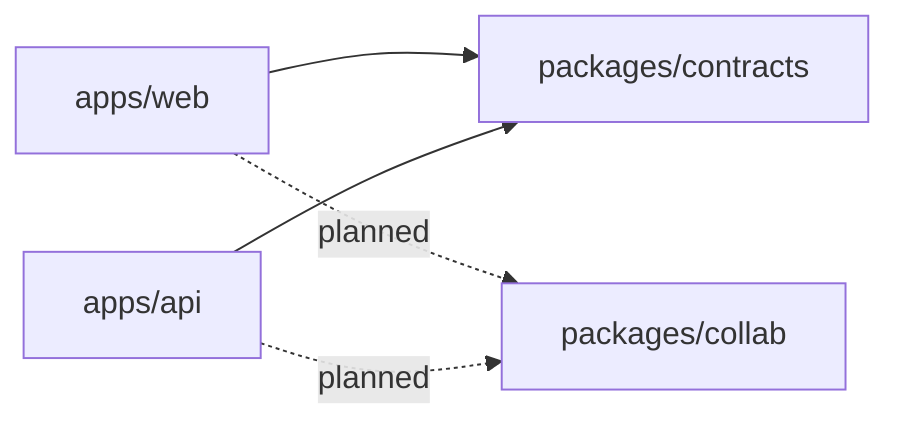

# Architecture

A React single-page app and a Fastify API in one npm-workspaces repo, sharing one contract package; PostgreSQL is the only store of record. The design idea everything follows: **the server decides what is committed and who wrote it** — clients render optimistically, but authorship and "saved" come from the server ([ADR-0002](adr/0002-collaboration-and-author-authorization.md), [ADR-0003](adr/0003-postgres-and-durable-commit.md), [ADR-0006](adr/0006-formal-stack.md)).

## Modules

| Module | Owns | Does not own |
| --- | --- | --- |
| `packages/contracts` | Request, response and (later) WebSocket message schemas; the route table | Behavior, I/O |
| `apps/api` | HTTP surface, validation, serialization, OpenAPI generation; later sessions, the collaboration socket, PG writes, the backup worker entry | UI, editor behavior |
| `apps/web` | Screens, routing, server-state caching, the typed API client; later the editor | Authorship or commit decisions |
| `prototypes/` | Frozen behavior baseline and evidence for ADR-0002/0005/0006 | Anything production imports |

Planned, created by the first change that needs it: `packages/collab` (Yjs `Y.Text` model, server-side update checks, shared by web and api; no app dependencies so it can be extracted later — ADR-0006 §18) and the worker entry in `apps/api`.

Each module's contract is in its `README.md`; read it before editing.

## Dependency direction

Arrows mean "may import". Anything not drawn is forbidden.

- `packages/*` never import `apps/*`; `apps/web` and `apps/api` never import each other. A type both need belongs in `packages/contracts`.
- Nothing outside `prototypes/` imports from `prototypes/`.
- Enforced today by review and the module READMEs' *Allowed dependencies*. TODO(owner): add a lint rule or `verify-dependency-direction` when `packages/collab` lands.

## Runtime flow

Current path (health check):

1. `apps/web` calls `callApi('health')`; method and path come from `routes.health`.
2. In development Vite proxies `/api` to the API; in production both are served same-origin.
3. `apps/api` handles the route registered from the same `routes.health`, and Fastify serializes the reply through its Zod schema.
4. The web client parses the response with the same schema and TanStack Query caches it.

Target path for an edit (phase 2, ADR-0006): editor step → `Y.Text` update persisted in IndexedDB → WebSocket → server update check → PG transaction (update + outbox) → "saved" ack and broadcast → worker → Google.

## Extension points

| Need | Extend | Not |
| --- | --- | --- |
| A new endpoint | An entry in `packages/contracts` `routes`, a handler in `apps/api` registered from it, `npm run openapi` | An inline path or shape in either app |
| A new screen | A route in `apps/web/src/main.tsx` | Fetch calls outside `src/api/client.ts` |

## Cross-cutting

- Configuration: repo-root `.env` (template `.env.example`), read by the API via `node --env-file-if-exists` and by the Vite proxy via `loadEnv`. No other config source.
- Errors: the API returns Fastify's error shape for now; the web client turns non-2xx into `ApiError`. TODO(owner): a contract error schema arrives with the first route that returns a domain error.
- Logging: Fastify's logger in the API process. Never log diary text, OAuth tokens or exports ([spec §11](diary-spec.md)).
- Persistence: PostgreSQL via Drizzle (schema and migrations in `apps/api` once the first table exists); browser IndexedDB for local copies and pending updates.
