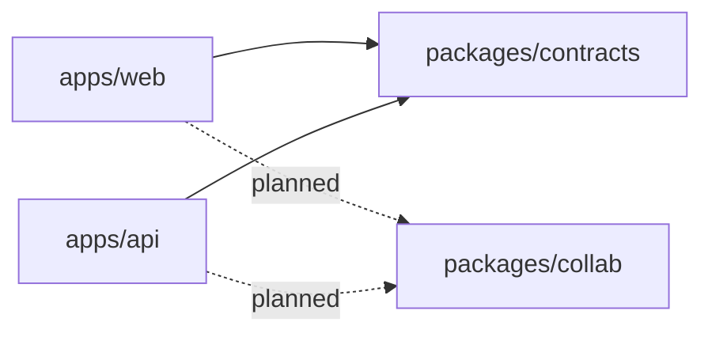

# Architecture

A React single-page app and a Fastify API in one npm-workspaces repo, sharing one contract package; PostgreSQL is the only store of record. The design idea everything follows: **the server decides what is committed and who wrote it** — clients render optimistically, but authorship and "saved" come from the server ([ADR-0002](adr/0002-collaboration-and-author-authorization.md), [ADR-0003](adr/0003-postgres-and-durable-commit.md), [ADR-0006](adr/0006-formal-stack.md)).

## Current decisions

What is decided today, by scope. Each line is the current answer; the linked record says why. When a record is superseded, update its line in the same PR (`verify-decision-format` rejects links to superseded or deprecated records here).

| Scope | Current decision | Record |
| --- | --- | --- |
| 领域 | One personal diary per owner/date; one fixed partner per account in the first release, one permanent pair space and separate binding periods; private date selections control live views, stopping freezes a readable version and explicit reopening grants the latest authorized owner/partner version | [spaces-and-invitations](adr/2026-10-25-spaces-and-invitations.md), [ADR-0001](adr/0001-diary-domain-and-time.md) (remaining authorship/time rules) |
| 协同 | The server enforces author protection on every edit path; implemented with one Yjs `Y.Text` per diary, client updates checked on the server against bound clientIDs, and a custom ProseMirror binding | [ADR-0002](adr/0002-collaboration-and-author-authorization.md), [ADR-0006](adr/0006-formal-stack.md) |
| 存储 | PostgreSQL is the store of record; "saved" only after commit; backups through a transactional outbox | [ADR-0003](adr/0003-postgres-and-durable-commit.md) |
| 备份 | One-way readable Google Doc plus a versioned recovery snapshot | [ADR-0004](adr/0004-google-export-and-recovery.md) |
| 技术栈 | Node 26, npm workspaces, TypeScript 6, React + Vite, Fastify, Drizzle, Zod contracts with generated OpenAPI, Vitest + Playwright | [ADR-0006](adr/0006-formal-stack.md) |
| 认证 | Better Auth for Google login and database sessions only; domain `users` separate from the auth tables; no merge by email; no Google tokens kept for login | [authentication-and-sessions](adr/2026-10-24-authentication-and-sessions.md) |

The personal-diary and sharing product rules were confirmed on 2026-10-25, narrowed on 2026-10-26 to a fixed partner after the first binding; the linked implementation ADR is adopted; implementation has not started. Its independent delivery is relationship management and private date-range configuration, with no diary content or Yjs. Storing a confirmed policy does not publish text. A separate diary/collaboration ADR must specify content storage, immutable versions, edit mapping and protocol before those features can be implemented; existing settings require explicit confirmation before actual publication. The first release has only the diary owner and their fixed partner as text authors, with no partner selector or content branches per partner. Ending a binding does not release the permanent pairing; only the original pair can restore collaboration. Wrong-account correction and changing partners are deferred in [future features](future-features.md), with no reset flow promised. Shared versions must not expose unauthorized dates or private changes made after sharing stopped. Private date settings and unshared diary existence are not recipient metadata. A personal latest view and a frozen historical view have separate identities. Rebinding alone does not reopen sharing; explicit reopening can expose the latest authorized version, including intervening changes.

## Modules

| Module | Owns | Does not own |
| --- | --- | --- |
| `packages/contracts` | Request, response and (later) WebSocket message schemas; the route table | Behavior, I/O |
| `apps/api` | HTTP surface, validation, serialization, OpenAPI generation, login and sessions (Better Auth), the domain `users` table; later the collaboration socket and the backup worker entry | UI, editor behavior |
| `apps/web` | Screens, routing, server-state caching, the typed API client; later the editor | Authorship or commit decisions |
| `prototypes/` | Frozen behavior baseline and evidence for ADR-0002/0005/0006 | Anything production imports |

Planned, created by the first change that needs it: `packages/collab` (Yjs `Y.Text` model, server-side update checks, shared by web and api; no app dependencies so it can be extracted later — ADR-0006 §18) and the worker entry in `apps/api`.

Each module's contract is in its `README.md`; read it before editing.

## Dependency direction

Arrows mean "may import". Anything not drawn is forbidden.

- `packages/*` never import `apps/*`; `apps/web` and `apps/api` never import each other. A type both need belongs in `packages/contracts`.
- Nothing outside `prototypes/` imports from `prototypes/`.
- Enforced today by review and the module READMEs' *Allowed dependencies*. TODO(owner): add a lint rule or `verify-dependency-direction` when `packages/collab` lands.

## Runtime flow

Current path (health check):

1. `apps/web` calls `callApi('health')`; method and path come from `routes.health`.
2. In development Vite proxies `/api` to the API; in production both are served same-origin.
3. `apps/api` handles the route registered from the same `routes.health`, and Fastify serializes the reply through its Zod schema.
4. The web client parses the response with the same schema and TanStack Query caches it.

Target path for an edit (phase 2, ADR-0006): editor step → `Y.Text` update persisted in IndexedDB → WebSocket → server update check → PG transaction (update + outbox) → "saved" ack and broadcast → worker → Google.

## Extension points

| Need | Extend | Not |
| --- | --- | --- |
| A new endpoint | An entry in `packages/contracts` `routes`, a handler in `apps/api` registered from it, `npm run openapi` | An inline path or shape in either app |
| A new screen | A route in `apps/web/src/main.tsx` | Fetch calls outside `src/api/client.ts` |

## Cross-cutting

- Configuration: repo-root `.env` (template `.env.example`), read by the API via `node --env-file-if-exists` and by the Vite proxy via `loadEnv`. No other config source.
- Sharing boundary (planned): one API domain owner resolves diary owner, permanent participants, current period, private date policy and share epoch/version for reads, writes, sync, search and export. Client filtering is never authorization. Wire shapes remain in contracts; version encoding and synchronization are designed with the diary kernel.
- Errors: every failure on our `/api/*` routes is the contract's `{ error: { code, message } }` ([authentication-and-sessions](adr/2026-10-24-authentication-and-sessions.md) D9); the web client turns it into `ApiError` with that `code`.
- Logging: Fastify's logger in the API process. Never log diary text, OAuth tokens or exports ([spec §11](diary-spec.md)).
- Persistence: PostgreSQL via Drizzle; schema in `apps/api/src/db/schema.ts`, generated migrations in `apps/api/drizzle/`, applied by `npm run db:migrate`. Local development uses `compose.yaml` (`npm run db:up`). Browser IndexedDB for local copies and pending updates.
