# 数字书页与轻拟物双窗设计包

本包保存这一轮设计评审稿，包括全部页面的交互示意与最新圆团子双窗效果。它是[提议中的 ADR](../../adr/2026-11-03-digital-paper-interface.md)的配套材料。**页面布局尚待逐项确认；模拟原型不是应用实现或验收证据。** 项目进度只见[开发路线](../../roadmap.md)。

## 先看效果

主页保留暖纸色、衬线标题和双人意象，优先提供继续写今天、对方新内容和最近日记；空间功能按自身的信息量排版。页面截图直接放在下面，也可以在浏览器打开 [index.html](./index.html)查看交互。它默认展示主页，顶部可以进入日记、一起和设置；底部可切换桌面、手机与保留书框三个比较视图。

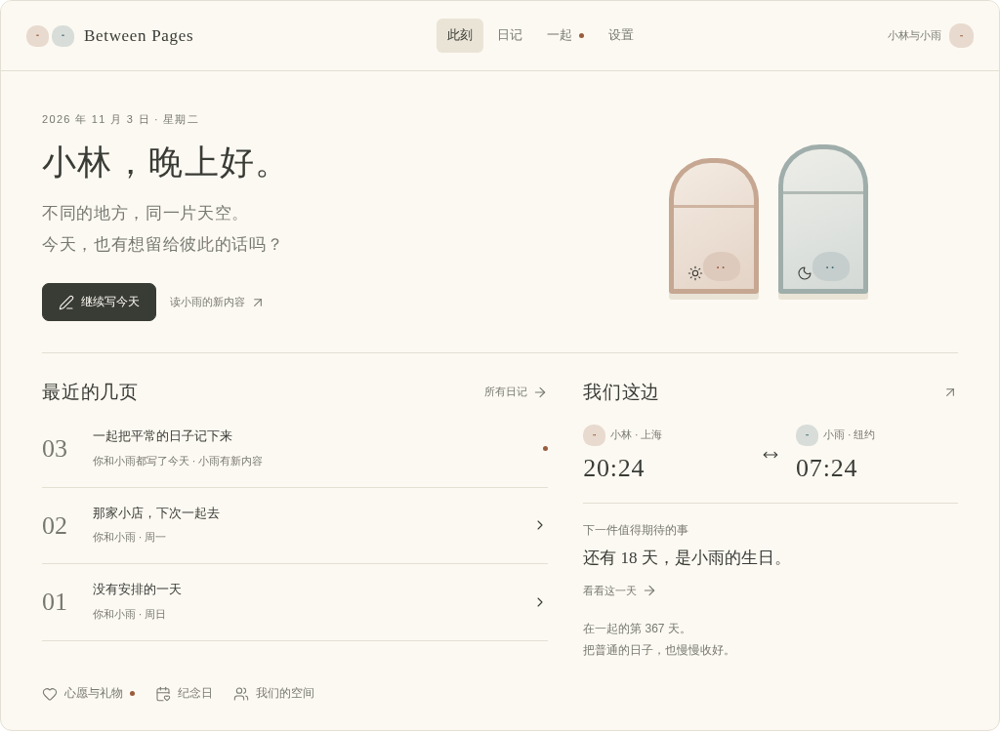

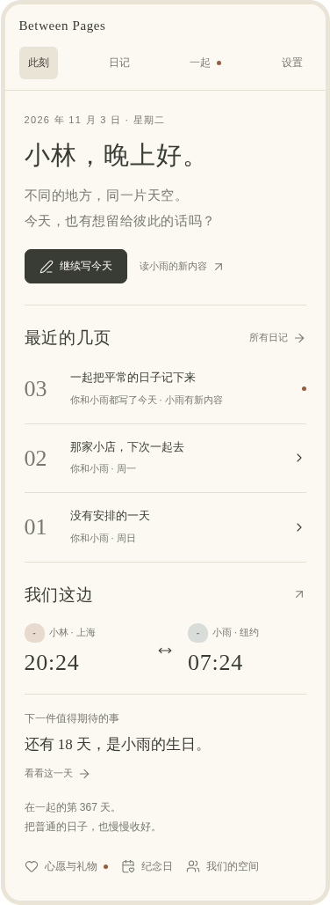

### 日记与心愿

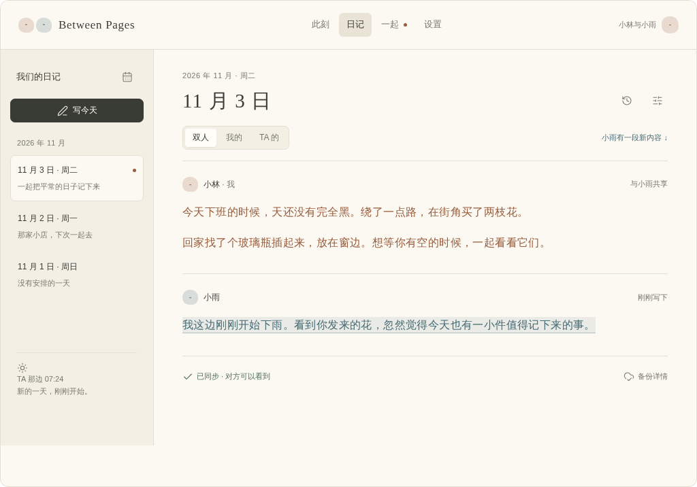

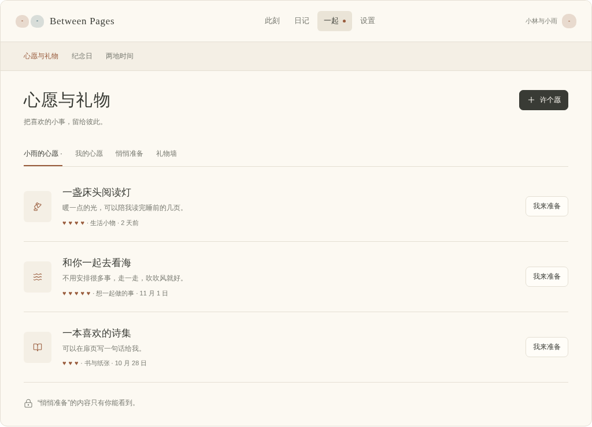

### 其他页面

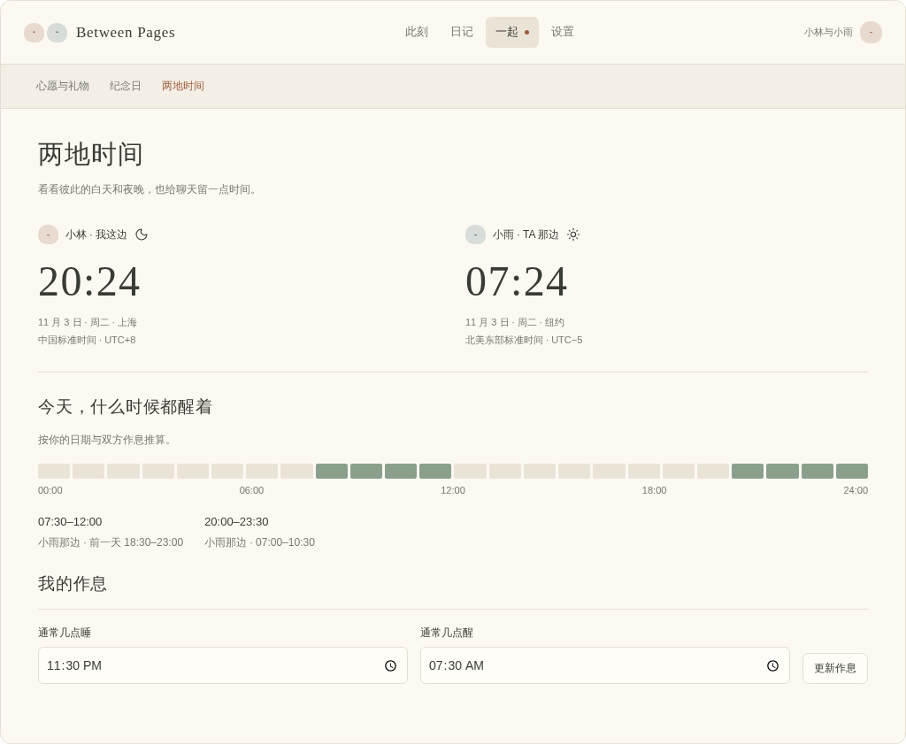

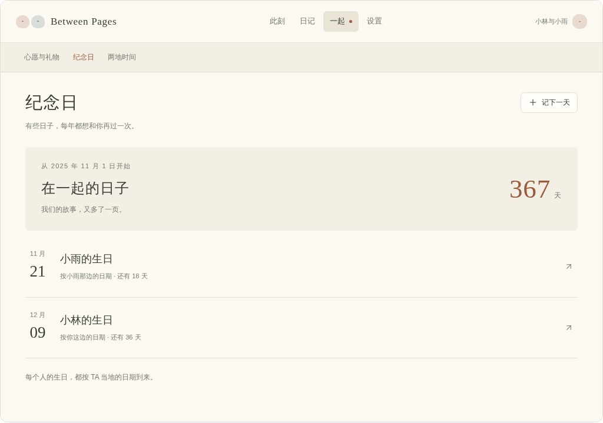

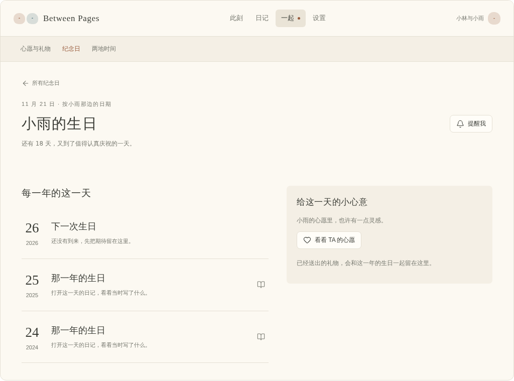

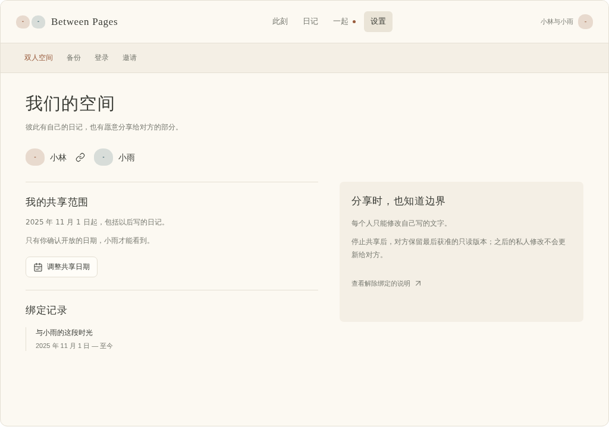

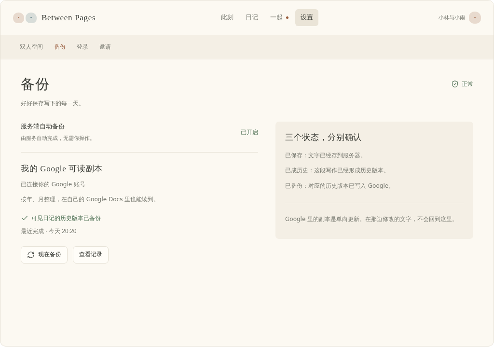

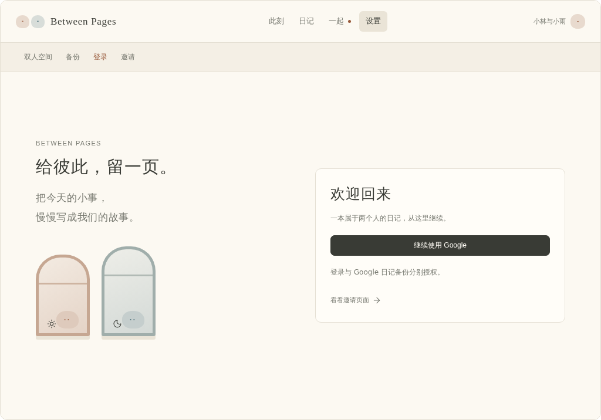

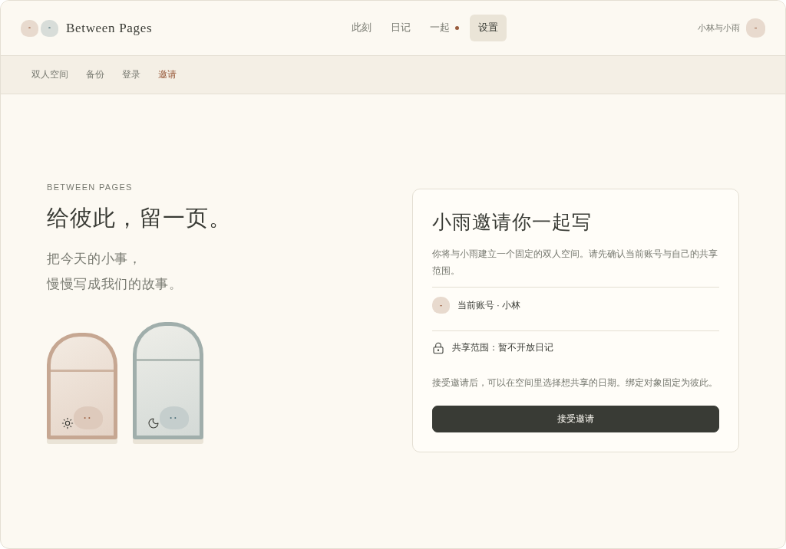

## 双窗与团子以这一轮效果稿为准

页面示意中的双窗仍是早期的平面占位。用户认为它过于简约，随后提出接近 Waffle Journal 的轻拟物数字插画质感，并要求团子也沿用这一质感、轮廓更圆。材质和角色造型应看以下效果稿；不能照搬页面占位图。

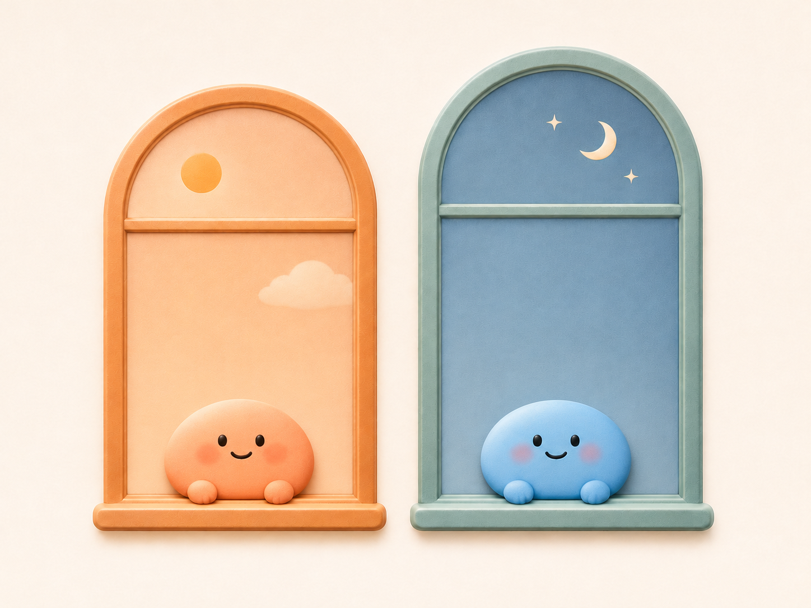

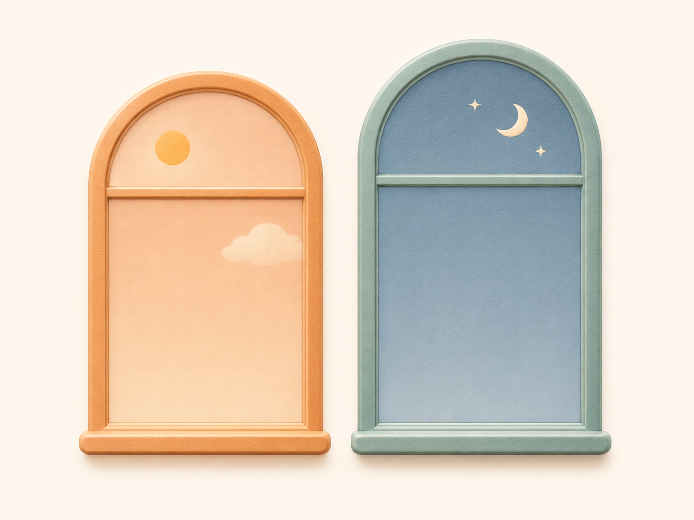

- 窗框：暖橙／青蓝，圆润内沿、窗台厚度、克制的高光、细微哑光纹理与接触阴影。
- 团子：保留橙蓝身份、小眼睛、笑脸与小手；身体饱满、顶部圆润、略扁，角色表面的纹理比窗框更轻。
- 正式实现：窗框、窗台、天空、日夜与光照分层；团子单独实现或使用独立透明素材。**不把生成的完整图片直接复制成窗口组件。** SVG/CSS 与程序纹理需另做实际尺寸和性能验证，效果稿不承诺逐像素复现。
- 两人配色表示身份，昼夜按各自真实当地时间变化；颜色与昼夜不能绑定成“橙色永远白天、蓝色永远夜晚”。

## 如何查看和复核

1. 在浏览器打开 [index.html](./index.html)。桌面默认「此刻」；日记可选日期、切换双人／我的／TA 的、展开历史与阅读选项；心愿可切换分类和打开新增表单。
2. 「一起」的次级导航可直接进入两地时间和纪念日；「设置」可进入空间、备份及用于评审的登录／邀请页。
3. 纪念日可新增模拟记录，空间页可预览共享范围确认，备份可展开模拟日志；这些反馈仅用于评审界面。
4. [source.html](./source.html) 是可编辑的原始预览片段；index.html 是带隔离预览容器的独立导出。两者保存同一套演示布局。不要把导出包装层或模拟路由搬到应用。

查看时需要联网取得导出预览所使用的公共样式与图标资源；截图在 GitHub 内可直接查看。无需启动 API、数据库或配置账号。

## 模拟与真实实现的边界

全部姓名、日记、日期、礼物、版本、备份日志和账号状态都是虚构演示数据，没有真实用户日记、令牌、账号邮箱或 API 请求。切换模拟登录、保存作息或新增心愿只更新本地示意；不证明持久化、作者保护、幂等或范围授权。正式页面仍必须复用真实 callApi、会话、编辑器、保存状态、共享确认和未读上报。

待评审的布局包括主页显示摘要、从固定双页调整为日期索引与主要正文、四个主要入口，以及状态收起的位置。这些建议还没有整体取代其他 PR 的书本决定。实施前需要按 ADR 的落地顺序明确采纳及部分取代关系。

登录和邀请在预览的设置导航中只是为了方便评审；正式应用的可进入条件由现有认证与邀请流程决定。手机示意只验证排版，实体手机支持与验收仍按开发路线安排。

## 生成来源与复现

页面由本次对话里的 HTML/CSS 示意导出。两张效果稿使用内置 imagegen 生成，引用原先双窗作为构图参考、前作团子作为角色参考，Waffle Journal 仅作材质研究；未保存第三方网站截图。

- 双窗提示词：保留双窗构图、橙蓝配色与日夜天空；增加细微材质、圆润内沿和浅浮雕厚度；窗台留空，不生成角色、文字或额外道具。
- 圆团子提示词：仅将已添加的两个角色改成饱满、略扁的圆团子；保留小手、五官、配色、哑光明暗；窗口、光照和背景保持原方向。
- 角色来自项目自己的前作，参考 [PR #61 中的原始双窗](https://github.com/ObsisMc/between-pages/blob/df5eb41e6dd5a8396964269313d78cc188ecc88e/apps/web/public/home/windows-watercolor.png)。
- 风格参考：[Waffle Journal](https://www.wafflejournal.com/)。本包不是其素材的再分发。

最终一轮的完整生成提示词保存在 [rounded-mascot.prompt.txt](./assets/rounded-mascot.prompt.txt)。

具体运行与截图口径见[设计预览验证](../../validation/digital-paper-design-2026-11-03.md)。
